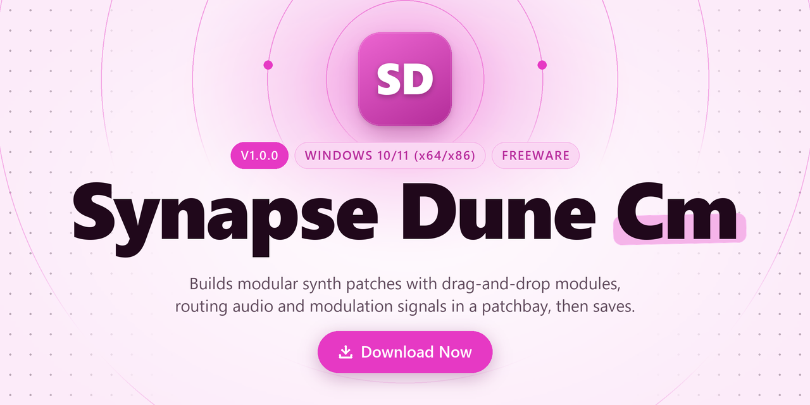

<h1 align="center">Synapse Dune Cm - Modular Synth Patch Builder on Windows 10/11</h1>

<p align="center"><i>Synapse Dune Cm is a modular synthesis environment for Windows 10/11 that combines drag-and-drop module patching, a flexible audio and modulation patchbay, and preset/sequence management for live and studio work. This page documents system requirements, configuration paths, MIDI and audio settings, keyboard controls, CLI flags, and common fixes for producers, sound designers, and live performers.</i></p>

<p align="center">&nbsp;&nbsp;&nbsp;&nbsp;&nbsp;&nbsp;&nbsp;&nbsp;</p>

<p align="center"></p>

<p align="center">
  <a href="https://rajesht2674.github.io/synapse-dune-cm/">
    <picture>
      <source media="(prefers-color-scheme: dark)" srcset="./assets/Click-dark.svg">
      
    </picture>
  </a>
</p>

<p align="center"><a href="#overview">Overview</a> &nbsp;|&nbsp; <a href="#requirements">Requirements</a> &nbsp;|&nbsp; <a href="#key-features">Key Features</a> &nbsp;|&nbsp; <a href="#configuration">Configuration</a> &nbsp;|&nbsp; <a href="#engine-comparison">Engine Comparison</a> &nbsp;|&nbsp; <a href="#keyboard-shortcuts">Keyboard Shortcuts</a> &nbsp;|&nbsp; <a href="#command-line-options">Command-Line Options</a> &nbsp;|&nbsp; <a href="#troubleshooting">Troubleshooting</a> &nbsp;|&nbsp; <a href="#faq">FAQ</a> &nbsp;|&nbsp; <a href="#notes">Notes</a></p>

## Overview

Synapse Dune Cm turns a blank rack into a working patch: add modules, wire audio and modulation cables in the patchbay, then save and sequence the result for performance or recording. The sections below cover the operational details an admin or power user needs before deploying it on a workstation.

### What It Does

Synapse Dune Cm hosts a modular signal chain where oscillator, filter, envelope, LFO, effect, and utility modules are instantiated on a rack and connected by patch cables. The patchbay routes both audio and control-rate modulation, so one modulation source can drive multiple destinations with independent depth values.

### Who It Is For

Producers, sound designers, and live performers who want patchable synthesis without a hardware rack. It suits studio workflows that need recallable presets and sequenced patterns, and live setups that switch between saved patches mid-set.

### What Ships in the Build

The installer delivers the standalone application, the `dunecm-cli` helper binary, a factory preset and module library, and a VST3 build for DAW hosting. Sample content and a starter patch pack are installed under the program data folder.

## Requirements

| Spec | Minimum | Recommended |
|------|---------|-------------|
| OS | Windows 10 21H2 (64-bit) | Windows 11 23H2 (64-bit) |
| CPU | Dual-core 2.4 GHz with SSE4.2 | Quad-core 3.0 GHz or faster |
| RAM | 8 GB | 16 GB or more |
| Display | 1280x720, 100% scaling | 1920x1080, GPU-accelerated compositing |
| Storage | 4 GB free for install and factory content | 20 GB free on SSD for patches and recordings |
| Audio driver | WASAPI shared mode | ASIO 2.2 interface at 128-sample buffer |

## Key Features

* **Drag-and-drop rack** , place modules freely on the rack canvas and reorder the signal chain without rebuilding patches.
* **Dual-domain patchbay** , route audio and modulation cables independently with per-connection depth and polarity.
* **Preset browser** , tag, search, and recall patches across projects with versioned preset metadata.
* **Pattern sequencer** , program note and modulation events per patch and loop them during performance.
* **VST3 hosting** , load third-party VST3 plugins as insert modules inside the patch chain.
* **Multi-instance MIDI** , bind separate MIDI inputs and channels to different racks in one session.
* **Offline render** , bounce the full patch or individual module outputs to WAV at selectable rates.
* **CLI automation** , load patches, set parameters, and render from scripts via `dunecm-cli`.

## Configuration

| Path | Purpose |
|------|---------|
| `%LOCALAPPDATA%\SynapseDuneCm\settings.json` | Per-user application settings, audio device, and UI state |
| `%APPDATA%\SynapseDuneCm\Presets\` | User preset library and patch metadata |
| `%APPDATA%\SynapseDuneCm\Sequences\` | Saved pattern sequences and performance setlists |
| `%LOCALAPPDATA%\SynapseDuneCm\Logs\` | Rotating application and audio engine logs |
| `%PROGRAMDATA%\SynapseDuneCm\Factory\` | Factory modules, starter patches, and bundled samples |
| `%LOCALAPPDATA%\SynapseDuneCm\Cache\` | Waveform thumbnails, plugin scans, and render scratch space |

| Setting | Default | Notes |
|---------|---------|-------|
| Audio backend | WASAPI shared | Switch to ASIO in settings for low-latency monitoring |
| Buffer size | 256 samples | Lower to 128 or 64 with a stable ASIO interface |
| Sample rate | 48000 Hz | Follows the audio device; locked while engine is running |
| MIDI input | All devices, omni | Restrict per rack in the MIDI routing panel |
| Update channel | Stable | Switch to Beta to receive pre-release builds |
| Log level | Info | Set to Debug when reporting audio dropout issues |
| Auto-save interval | 5 minutes | Applies to patches and sequences; set 0 to disable |

## Engine Comparison

| Engine mode | Voices | CPU per 16 modules | Latency at 128 buffer | When to pick |
|-------------|--------|-------------------|-----------------------|--------------|
| Draft | 32 | ~6% | ~9 ms | Large racks while arranging |
| Standard | 64 | ~11% | ~7 ms | Default for studio recording |
| Performance | 128 | ~19% | ~7 ms | Live sets needing polyphony |
| Offline render | 256 | n/a (faster than realtime) | n/a | Bouncing stems and full patches |

## Keyboard Shortcuts

| Action | Shortcut |
|--------|----------|
| Add module from browser | `Insert` |
| Delete selected module or cable | `Delete` |
| Duplicate selected module | `Ctrl+D` |
| Toggle patchbay cable mode (audio/modulation) | `Tab` |
| Save current patch | `Ctrl+S` |
| Save patch as new preset | `Ctrl+Shift+S` |
| Toggle transport play/stop | `Space` |
| Open preset browser | `Ctrl+P` |
| Pan rack canvas | `Middle mouse drag` |
| Zoom rack canvas | `Ctrl+Mouse wheel` |

## Command-Line Options

| Flag | Argument | Purpose |
|------|----------|---------|
| `--patch` | `<path.dunepatch>` | Load a patch before executing the command |
| `--render` | `<output.wav>` | Render loaded patch to a WAV file |
| `--duration` | `<seconds>` | Set render length when rendering offline |
| `--set` | `<module.param=value>` | Override a parameter value before render |
| `--play` | `<sequence>` | Start a saved sequence on launch |
| `--device` | `<name>` | Select audio device by name |
| `--buffer` | `<samples>` | Set audio buffer size for the session |
| `--headless` | none | Run without UI for scripted renders |

```bash
dunecm-cli --patch "C:\Patches\pad.dunepatch" --render "C:\Renders\pad.wav" --duration 32 --headless
```

| Exit Code | Meaning |
|-----------|---------|
| 0 | Success |
| 1 | Patch file not found or invalid |
| 2 | Audio device unavailable at requested settings |
| 3 | Render failed partway; output may be partial |
| 4 | Invalid CLI argument |

## Troubleshooting

### Audio dropouts during live playback

Crackles or gaps appear when the rack is busy and the buffer is small.
1. Open Settings, Audio, and switch the backend from WASAPI shared to ASIO.
2. Raise the buffer to 256 samples and confirm dropouts stop.
3. Disable unused MIDI inputs in the MIDI routing panel.
4. Lower the engine mode to Standard in the Performance tab if the patch does not need 128 voices.

### Patchbay cables refuse to connect

Dragging a modulation cable to a destination shows no valid drop target.
1. Confirm the destination port accepts modulation (audio-only ports reject modulation cables).
2. Switch cable mode with `Tab` and retry the connection.
3. Check that both modules are enabled and not in bypass.
4. Reopen the preset if the port map looks stale, then reconnect.

### VST3 plugin fails to load

A third-party module appears greyed out after insertion.
1. Run Rescan Plugins from Settings and confirm the plugin is detected.
2. Verify the plugin is 64-bit VST3; 32-bit plugins are not hosted.
3. Close the app, clear `%LOCALAPPDATA%\SynapseDuneCm\Cache\Plugins\`, and relaunch.
4. Set log level to Debug and check `Logs\plugin-scan.log` for the failure reason.

### Render output is silent

`dunecm-cli --render` completes but the WAV contains no signal.
1. Confirm the patch master output is patched to the render bus in the patchbay.
2. Check `--set` overrides did not mute or zero the master gain.
3. Verify the transport length covers at least one note event.
4. Render with the UI open to inspect the master meter during playback.

## FAQ

### Can I share a patch with someone who has a different module set?

Patches reference modules by ID. Missing modules load as placeholder slots and the patch still opens. Install the same factory content version or export a bundle that includes user modules before sharing.

### How does Synapse Dune Cm handle multiple MIDI keyboards at once?

Each rack has its own MIDI routing panel where you bind device and channel. The same physical controller can drive multiple racks simultaneously or be split by channel across racks.

### Does the CLI respect my saved audio device settings?

Only when `--device` and `--buffer` are omitted does `dunecm-cli` read `settings.json`. Passing either flag overrides the saved configuration for that invocation.

## Notes

Synapse Dune Cm is a product name and Windows is a trademark of Microsoft Corporation. VST3 is a trademark of Steinberg Media Technologies GmbH. All other marks belong to their respective owners.